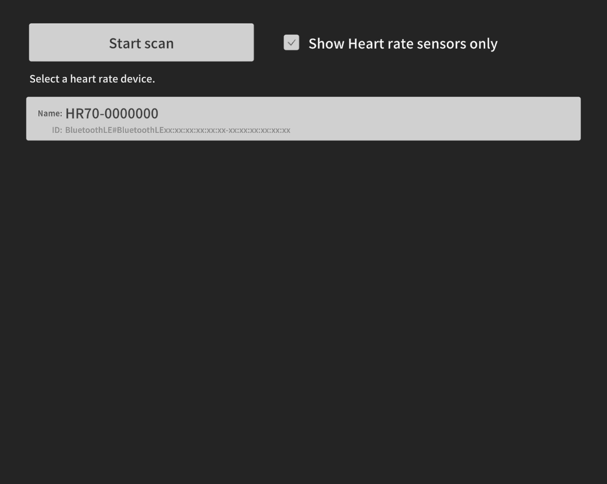
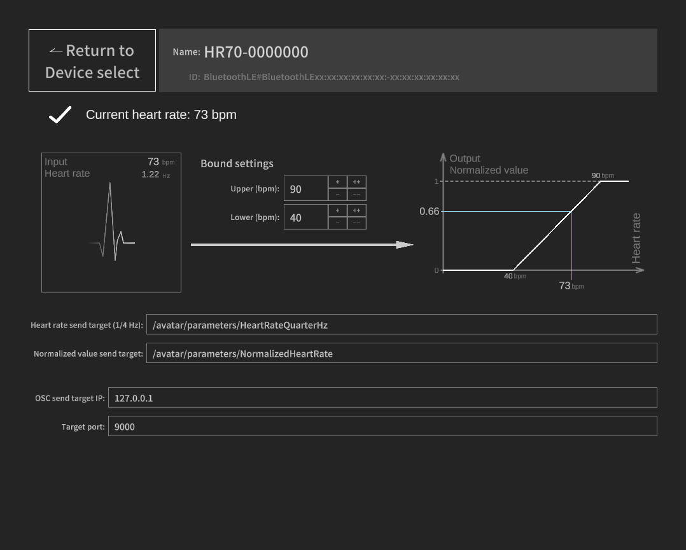

# BleHeartRate-OscSender
Read Heart rate value from BLE device.
A tool sends heart‑rate data from a BLE device to an OSC server.

## Overview
This application reads heart‑rate data from a BLE device and sends the data to an OSC server (e.g. VRChat).
The BLE device must implement the **Heart Rate Service** (e.g. COOSPO HW807/HW9, IGPSPORT HR70, etc.).

After selecting a BLE heart-rate monitor device, the app retrieves the heart-rate data and sends the following values via OSC:
* One-quarter of the beats-per-minute value (intended for use in VRChat, where various parameter limitations make it more practical to send a reduced value)
* A normalized value (0–1) calculated from the specified minimum and maximum heart rates

With this, you can achieve effects such as (in VRChat, for example):
* Flashing accessories in sync with your heart rate
* Changing accessory colors depending on heart-rate increases or decreases

## How to use
* Start scanning for BLE devices and select your heart-rate monitor from the list.

The app will automatically search for and connect to the heart-rate service.
* Adjust the OSC parameter name and target IP/port as needed.


When the application starts, it automatically reconnects to the BLE device that was connected during the previous session.

The device list defaults to heart-rate candidates. Turn off **Show Heart rate sensors only** to show all discovered devices if your sensor does not advertise its heart-rate service. This uses the scene's Toggle directly under `HRServiceOnlyToggleArea`. Connection availability changes do not disable selection; support and subscription are checked when you select a device.

The app targets 30 fps in both foreground and background, with no additional background rendering throttle. The heart-rate graph, BLE reception, and OSC output continue while unfocused.

## Project layout

| Directory | Contents |
| --- | --- |
| `Assets/Scenes`, `Assets/Prefabs`, `Assets/GUI`, `Assets/Fonts` | Application scenes and imported visual assets |
| `Assets/Scripts/BLE`, `OSC`, `Settings`, `UI` | Application scripts grouped by responsibility |
| `Assets/Plugins/BLE` | Native DLL and managed interop definitions |
| `Assets/Demo/Scenes`, `Assets/Demo/Scripts` | Example scenes and legacy sample scripts |
| `Assets/Editor/UI` | Custom inspectors |
| `ArtSource~/GUI/Icon` | Editable Affinity, PowerPoint, and SVG artwork sources |
| `Native~/BleWinrtDll` | Native source submodule and its build script |
| `Docs/Images` | README screenshots |

The `~` suffix keeps native code and artwork sources out of Unity's asset import.
Keep exported application images in `Assets/GUI/Icon`. When moving Unity assets,
move their `.meta` files with them to preserve scene and prefab references.
Local editor settings (`.vscode`) and Unity caches are excluded from Git.

## Native source setup

`Native~/BleWinrtDll` is a Git submodule referencing
[shun1053/BleWinrtDll](https://github.com/shun1053/BleWinrtDll). The parent repository
pins its commit (currently `21bb1bf975ca2feddefb76b7ad17c2fc149f7b24`), so checkouts use
the same native source without following `main` automatically.

For a new checkout:

```powershell
git clone --recurse-submodules https://github.com/shun1053/BleHeartRate-OscSender.git
```

For an existing checkout, or after pulling changes to the pinned commit:

```powershell
git submodule update --init --recursive
```

The application includes the native DLL at `Assets/Plugins/BLE/BleWinrtDll.dll`.
To rebuild it, install the Visual Studio C++ tools and Windows SDK `10.0.26100.0`,
then run from the project root:

```powershell
powershell -NoProfile -ExecutionPolicy Bypass -File Native~/BleWinrtDll/build.ps1
Copy-Item Native~/BleWinrtDll/x64/Release/BleWinrtDll.dll Assets/Plugins/BLE/BleWinrtDll.dll -Force
```

Close Unity and other applications using the DLL before replacing it.

To update the dependency intentionally, fetch and check out a published commit in
the submodule, then record the new reference in the parent repository:

```powershell
git -C Native~/BleWinrtDll fetch origin
git -C Native~/BleWinrtDll checkout --detach <commit-sha>
git add Native~/BleWinrtDll
git commit -m "Update BleWinrtDll submodule"
```

# Credits / Third-Party Assets
This project uses the following third-party libraries and assets:

## uOSC
- Repository: https://github.com/hecomi/uOSC  
- Author: hecomi  
- License: MIT License  
- This package is referenced via Unity's Package Manager.  
  A local copy of the license is not included; please refer to the license at the repository above.

## Noto Sans JP
- Homepage: https://fonts.google.com/noto  
- Author: Google / Adobe  
- License: SIL Open Font License 1.1 (OFL)  
- A copy of the OFL license is included as `OFL.txt` in this project.

## BleWinrtDll (Forked Version)
- Original Repository: https://github.com/adabru/BleWinrtDll  
- Forked Repository: https://github.com/shun1053/BleWinrtDll  
- Author (Original): adabru  
- License: MIT License  
- This project uses a custom-built DLL compiled from my forked version of the library.  
  Modifications (if any) are documented in the forked repository.  
- The original license terms apply; a copy of the MIT License is available in the original repository.
